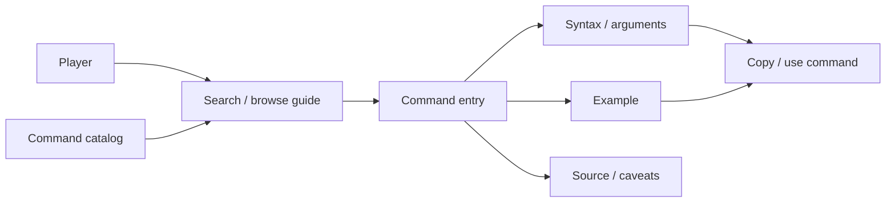
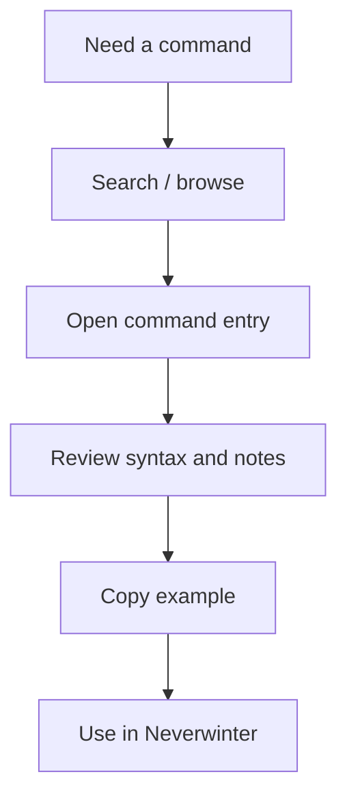
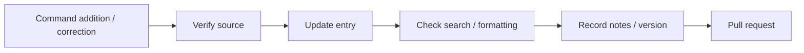

<div align="center">

# Neverwinter Command Guide

**A searchable, structured Neverwinter command reference designed to make console commands, syntax, examples, and practical usage easier to understand.**


[Browse source](https://github.com/Nischhalsubba/neverwinter-command-guide/tree/main) · [Issues](https://github.com/Nischhalsubba/neverwinter-command-guide/issues)

</div>

## Overview

**Neverwinter Command Guide** is documented as a reference product: users need to find a command, understand what it does, see the required syntax or arguments, and copy an example without confusing verified behavior with speculation.

<details open>
<summary><strong>🏗️ Interactive reference architecture</strong></summary>



</details>

## Player flow



## Audience guide

| Audience | Focus |
|---|---|
| Players | Fast command lookup and understandable examples |
| Developers | Search, data model, filtering and copy behavior |
| Designers | Reference density, scanning, responsive search and states |
| Maintainers | Provenance, verification date, version notes and corrections |

## Getting started

```bash
git clone https://github.com/Nischhalsubba/neverwinter-command-guide.git
cd neverwinter-command-guide
```

Use the manifests and lockfiles in the repository to determine the current runtime and commands.

## Content quality

Separate verified commands from uncertain or historical notes. Use consistent syntax formatting, explain arguments, preserve source context, and avoid presenting outdated commands as current game behavior.

## SEO & discoverability

Use natural terms such as **Neverwinter commands, Neverwinter console commands, command guide, command syntax, Neverwinter keybind commands, and Neverwinter command reference** only where supported by actual catalog content.

## Contribution flow


